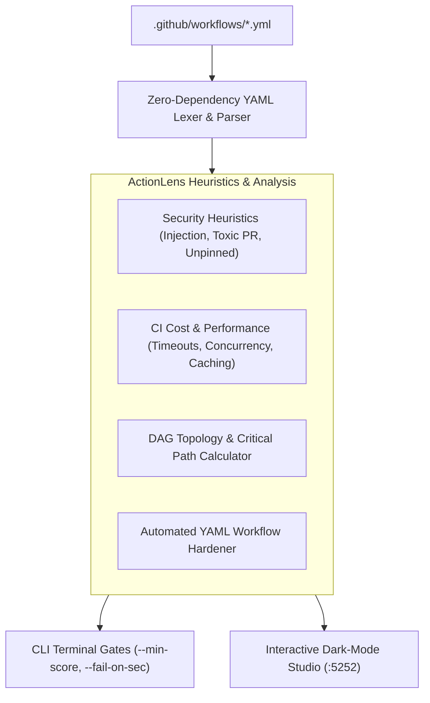

# ⚡ ActionLens

> **Developer-First GitHub Actions Workflow Linter, Security Auditor, CI/CD Optimizer & Visual Pipeline Studio.**  
> Crafted with precision by **[Jatin Sharma](https://jatinsh.netlify.app/)** • GitHub: **[@raghav1924](https://github.com/raghav1924)**

[](https://opensource.org/licenses/MIT)
[](https://github.com/raghav1924/actionlens/actions)
[](https://nodejs.org/)
[](https://www.typescriptlang.org/)
[](https://github.com/raghav1924/actionlens)
[](https://jatinsh.netlify.app/)

---

## 🌟 Why ActionLens?

GitHub Actions is the default automation backbone for modern software engineering teams. However, workflow YAML files (`.github/workflows/*.yml`) are written without local compile-time safety or security guardrails:

- 🚨 **Script Injections in `run:` Steps:** Untrusted context variables like `${{ github.event.issue.title }}` or `${{ github.event.pull_request.head.ref }}` evaluated in bash scripts allow attackers to run arbitrary code and steal repo secrets.
- ☠️ **The Toxic `pull_request_target` Triad:** Combining `pull_request_target` with checkouts of PR code gives fork pull requests read/write access to production credentials.
- 📦 **Unpinned Actions & Supply-Chain Attacks:** Referencing mutable tags like `@v1` or `@main` exposes builds to compromised upstream maintainer accounts.
- ⏳ **CI Bloat & Cost Inefficiencies:** Missing `timeout-minutes` allows hung tests to burn 6 hours of runner credits; missing `concurrency` cancellations duplicate runs on every rapid commit.

**ActionLens** provides a zero-dependency static analysis engine, DAG visualizer, and local dark-mode Web Studio to audit, optimize, and automatically harden your GitHub Actions workflows.

---

## 🏗️ Architecture Overview



---

## ✨ Key Features

- 🔍 **Zero-Dependency YAML AST Parser:** Fast, resilient indentation-aware parser built with pure Node.js standard libraries.
- 🛡️ **12+ Production Security & Performance Heuristics:** Pinpoint script injections (`SEC-001`), toxic `pull_request_target` checkouts (`SEC-002`), unpinned actions (`SEC-003`), permissive tokens (`SEC-004`), missing timeouts (`OPT-001`), and missing concurrency cancellations (`OPT-002`).
- ⚡ **Pipeline DAG & Critical Path Engine:** Visualizes multi-job `needs:` dependencies, isolates the longest execution bottleneck, and calculates maximum parallelization.
- 🛠️ **Automated Auto-Hardener (`actionlens fix`):** Non-destructively patches workflow files by injecting least-privilege permissions, concurrency cancel-in-progress blocks, job timeouts, and modern action versions.
- 🎨 **Dark-Mode Visual Studio:** Self-contained, responsive dashboard running on `http://localhost:5252` with live Mermaid DAG previews and one-click fixes.
- 🚀 **Zero External Dependencies:** Built with pure TypeScript and Node.js built-ins (`node:fs`, `node:path`, `node:http`, `node:crypto`).

---

## 📋 Audited Heuristic Rules

| Code | Category | Severity | Description |
|---|---|---|---|
| `SEC-001` | Security | **CRITICAL** | Untrusted context expression in inline shell script (command injection risk) |
| `SEC-002` | Security | **CRITICAL** | Toxic `pull_request_target` checking out untrusted pull request head code |
| `SEC-003` | Security | **HIGH** | Unpinned third-party action using mutable branch or version tag |
| `SEC-004` | Security | **HIGH** | Overly permissive default `GITHUB_TOKEN` without explicit permissions block |
| `SEC-005` | Security | **HIGH** | Unmasked secret expression logged or echoed in run step |
| `OPT-001` | Performance | **MEDIUM** | Missing `timeout-minutes` ceiling on job execution |
| `OPT-002` | Performance | **MEDIUM** | Missing `concurrency` cancellation group on push / pull_request events |
| `OPT-003` | Performance | **LOW** | Missing package manager cache (`cache: 'npm'` / pnpm / yarn) |
| `OPT-004` | Reliability | **MEDIUM** | Deprecated Node.js action version runtime (`@v1`, `@v2`) |
| `REL-002` | Reliability | **LOW** | Unfiltered push trigger running full CI on markdown / documentation changes |

---

## 🚀 Quickstart

### 1. Installation & Direct Usage
```bash
# Clone the repository
git clone https://github.com/raghav1924/actionlens.git
cd actionlens

# Compile TypeScript
npm run build

# Run full test suite
npm test
```

### 2. Audit Workflows
```bash
# Audit all workflows in current project
node dist/bin.js audit .

# Enforce strict CI quality gate
node dist/bin.js audit . --min-score=85 --fail-on-sec
```

### 3. Automatically Harden a Workflow
```bash
# Injects permissions, concurrency cancellation, and job timeouts
node dist/bin.js fix .github/workflows/ci.yml
```

### 4. Visualize Pipeline DAG
```bash
# Render job dependency graph and critical path
node dist/bin.js dag .github/workflows/ci.yml
```

### 5. Launch Dark-Mode Web Studio
```bash
# Start embedded visual inspector
node dist/bin.js studio --port=5252
# Open http://localhost:5252 in your browser
```

---

## 🧑‍💻 Author

**Jatin Sharma**  
- Portfolio: [https://jatinsh.netlify.app/](https://jatinsh.netlify.app/)  
- GitHub: [@raghav1924](https://github.com/raghav1924)  
- Email: `raghavjatin245@gmail.com`

---

## 📄 License

This project is licensed under the MIT License - see the [LICENSE](LICENSE) file for details.

